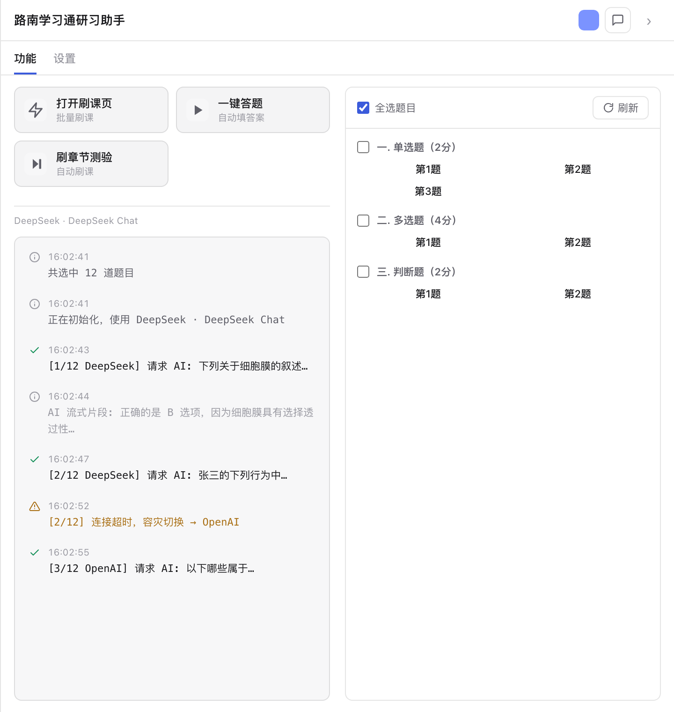
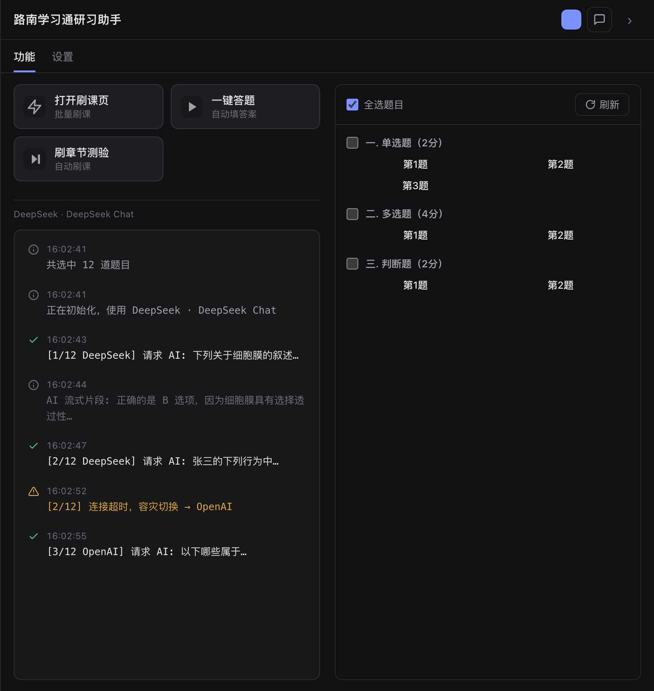
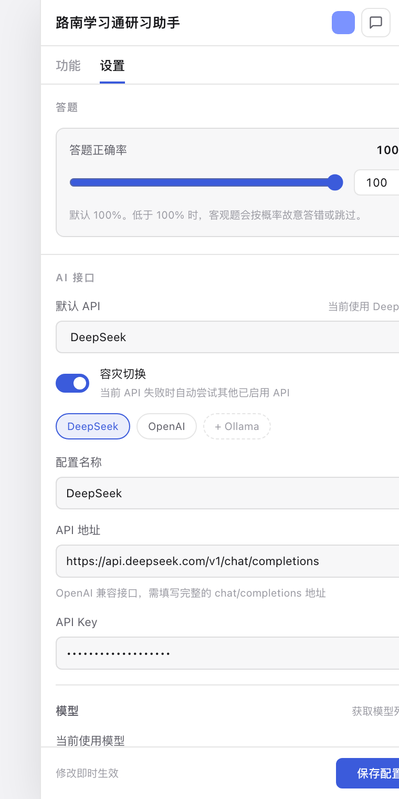
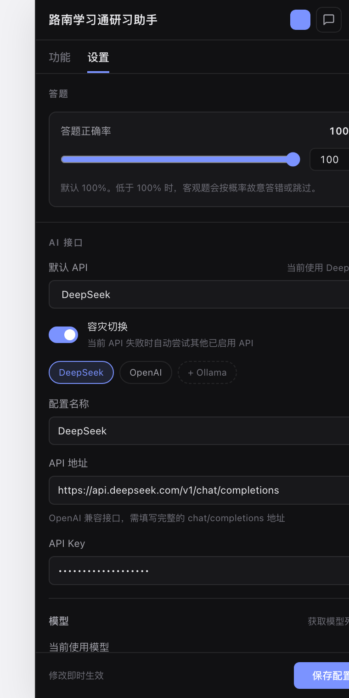

# 路南云 · 学习通 AI 研习助手

学习通（超星）刷课 + 自动答题用户脚本 · 侧边栏形态 · 极简界面 · 支持自建 API 与容灾切换

一个运行在浏览器用户脚本管理器（脚本猫 / Tampermonkey / Violentmonkey）里的学习通辅助工具。以右侧滑出侧边栏的方式工作，不遮挡课件，支持章节刷课、作业与测验自动作答、多 AI 接口配置与失败自动切换。

<p>
  
  
</p>

<p>
  
  
</p>

> 截图取自脚本自身样式，深浅色跟随系统。

## 功能

| 模块 | 说明 |
| --- | --- |
| 一键答题 | 识别当前页面题目，调用 AI 生成答案并自动填入，支持单选 / 多选 / 判断 / 填空 |
| 刷章节测验 | 按章节顺序自动推进，完成测验后跳转下一节 |
| API 专刷 | 独立页面批量刷视频与文档，支持正常模式与补时长模式 |
| 多接口管理 | DeepSeek / OpenAI / Ollama 及任意 OpenAI 兼容接口，可并存并设置默认与当前使用 |
| 容灾切换 | 当前接口出错时自动按顺序切换到其他已启用接口 |
| 答题正确率 | 可设置 0–100%，按概率故意答错或跳过，用于模拟真实作答 |
| 粘贴解除 | 作业页解除粘贴、右键、选择、复制限制（可选） |
| 题目选择 | 右栏展示识别到的题目分组，可勾选只答其中一部分 |

## 安装

1. 安装用户脚本管理器：[脚本猫](https://scriptcat.org/)（推荐）或 Tampermonkey。
2. 点击脚本文件，管理器会弹出安装界面，确认安装。
3. 打开任意 `chaoxing.com` 学习页面，右侧会出现「研习」竖条，点击展开面板。

## 配置 AI 接口

脚本不自带任何 AI 服务，也不含任何密钥，需要你填入自己的接口。打开面板「设置 → AI 接口」：

1. 点顶部的 `+ DeepSeek` / `+ OpenAI` / `+ Ollama` 新增一个配置（也可以直接在现有卡片里改）
2. 填写 **API 地址**，必须是完整的 `chat/completions` 地址，例如 `https://api.deepseek.com/v1/chat/completions`
3. 填写 **API Key**，然后点「获取模型列表」拉取可用模型并选择

Ollama 本地地址 `http://localhost:11434/v1/chat/completions` 无需 Key。多个接口可以同时存在，在顶部选「默认 API」，并打开「容灾切换」让失败时自动接管。

## 目录结构

```
路南云🏅学习通AI研习助手|刷课+答题+API专刷.js   用户脚本源码（单文件）
```

- 本工具仅供学习研究，请遵守课程与平台规则。

